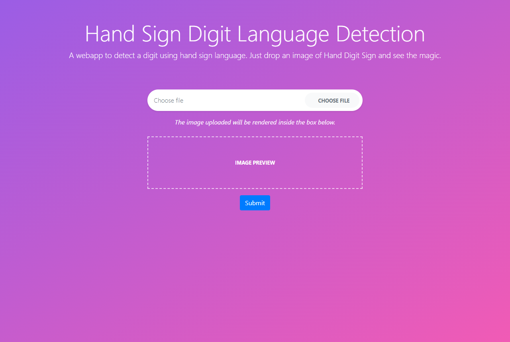
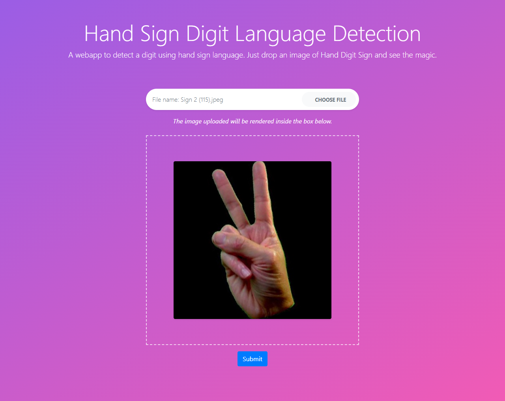
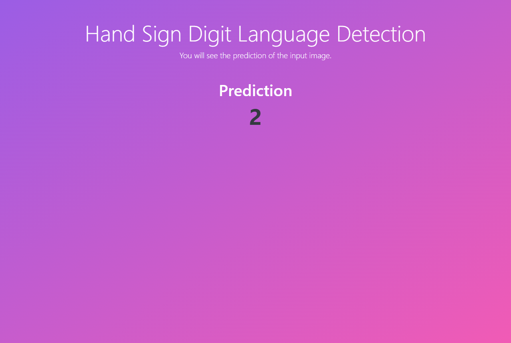
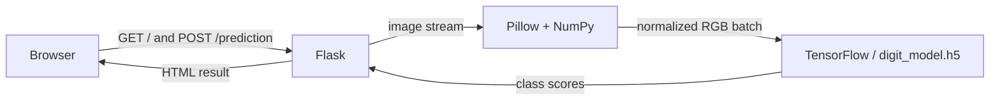
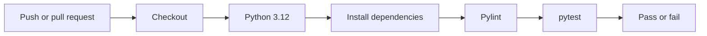
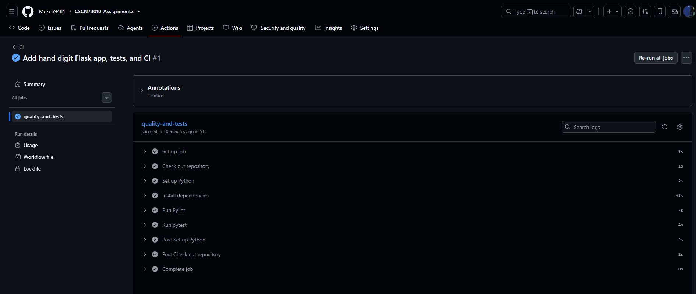
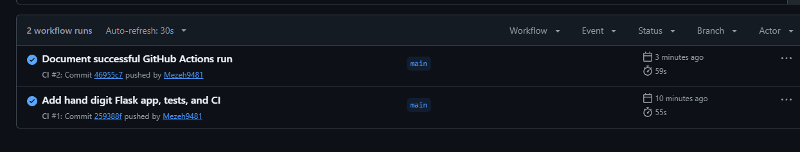

# Assignment 2 report

**Course:** CSCN73010 - Software Quality III: Build and Release
**Project:** Hand Digit Image Recognition
**Starting point:** [Sachin-crypto/Flask_Image_Recognition](https://github.com/Sachin-crypto/Flask_Image_Recognition), revision `62d8114`
**Individual GitHub repository:** https://github.com/Mezeh9481/CSCN73010-Assignment2 (main branch pushed; first CI run passed).

## 1. Setup and local deployment

The starting project is a Flask upload page backed by a Keras hand-sign digit classifier. It includes `digit_model.h5` and sample JPEG files in `test_images/`. The revised app was set up in a Python 3.12 virtual environment with `requirements-dev.txt`. The commands to install, run, lint, test, and enable pre-commit are in `Readme.md`.

The initial `model.py` used a machine-specific `D:/SACHIN/...` path. The original TensorFlow 2.10 dependency also did not fit the available Python 3.12 runtime. I changed the model path to a file beside `model.py` and updated the dependencies. In this sandboxed environment, virtual environment creation initially failed because Python's temporary directory was not writable; setting `TMP` and `TEMP` to a local workspace folder resolved it. The modern Keras loader then rejected an obsolete `groups: 1` setting saved in a `DepthwiseConv2D` layer. A narrow loading adapter removes only that legacy setting.

A live browser run used `test_images/2/Sign 2 (115).jpeg`. The app displayed a prediction of **2**. The server log recorded `GET /` and `POST /prediction` returning HTTP 200.

*Figure 1. Flask upload page at http://127.0.0.1:5000/.*

*Figure 2. Sample image preview before submission.*

*Figure 3. Prediction returned by the bundled model.*

## 2. Legacy code and architecture

| Component | Purpose |
| --- | --- |
| `app.py` | Flask configuration, routes, upload validation, result rendering |
| `model.py` | Image conversion and normalization; lazy model loading and class selection |
| `digit_model.h5` | Trained ten-class hand-sign digit model |
| `templates/index.html` | Image upload form |
| `templates/result.html` | Prediction or error page |
| `templates/layout.html` | Shared page layout |
| `static/css/`, `static/js/` | Styling and image preview |
| `test_images/` | Sample input images |

The browser requests `GET /` and receives the upload form. It sends a multipart `POST /prediction` with a `file` field. Flask checks that a file was selected. Pillow opens it, converts it to RGB, and resizes it to 224 by 224 pixels. NumPy converts it to a normalized `1 x 224 x 224 x 3` batch. The cached TensorFlow/Keras model scores ten classes; the highest score becomes the displayed digit. Invalid images receive HTTP 400 with a useful message.

## 3. Pylint, improvements, and pre-commit

`.pylintrc` sets the Python target to 3.12 and the line limit to 100 characters. Pylint checks `app.py`, `model.py`, `tests/`, and `tools/`. The route no longer uses a bare `except`, and it distinguishes missing, invalid, and valid uploads. The model path is portable, loading is delayed until prediction, and image preprocessing supports grayscale input. Editor settings and compiled Python files were removed from tracking.

`.pre-commit-config.yaml` runs local text/YAML checks, Pylint, and pytest. The text hook checks UTF-8, trailing whitespace, final newlines, and YAML syntax. It uses the active Python environment. Local `pre-commit run --all-files` passed all three hooks.

| Check | Before correction | After correction |
| --- | --- | --- |
| Pylint | 7.65/10, exit code 30; bare `except`, missing docstrings, inconsistent return, and other findings | 10.00/10, exit code 0 |
| Pytest | 3 failed, 5 passed; missing, empty-name, and invalid uploads returned 200 | 9 passed, 2 TensorFlow/protobuf deprecation warnings |
| Real model | Modern Keras rejected legacy `DepthwiseConv2D.groups` | Model loaded and predicted class 2 for the sample |

The saved baseline command outputs are in `evidence/baseline-pylint.txt` and `evidence/baseline-pytest.txt`. The two final warnings come from a dependency and do not fail the tests.

## 4. Automated test cases

| Test group | Covered behavior |
| --- | --- |
| Home | Upload form returns HTTP 200 |
| Valid upload | A real PNG is preprocessed; a fake predictor produces the expected HTML result |
| Missing/empty file | Clear HTTP 400 response |
| Invalid bytes | Non-image content returns HTTP 400 and never reaches prediction |
| Wrong method | `GET /prediction` returns HTTP 405 |
| Preprocessing | Grayscale is converted to normalized RGB with the expected batch shape |
| Class selection | The highest model score becomes an integer class |
| Bundled model | The real `.h5` file loads and predicts a digit from a sample image |

Mocked tests keep the route checks fast. The bundled-model test exercises the real model file and catches compatibility regressions. The final command was `python -m pytest -q`, which reported **9 passed**.

## 5. CI workflow and progression

The workflow in `.github/workflows/ci.yml` runs on pushes and pull requests. It checks out the repository, sets up Python 3.12, installs `requirements-dev.txt`, runs Pylint, and runs pytest. A failed command fails the job.

Local tests found three genuine input-handling failures, and Pylint rated the earlier code 7.65/10. After the route and model corrections, all nine tests pass and Pylint rates the code 10.00/10. The saved baseline logs document this local progression.

The first [GitHub Actions run](https://github.com/Mezeh9481/CSCN73010-Assignment2/actions/runs/40164432359) was triggered by commit `259388f` on `main`, pushed by Mezeh9481. The `quality-and-tests` job succeeded, including Pylint and pytest. The [second run](https://github.com/Mezeh9481/CSCN73010-Assignment2/actions/runs/40164836798) was triggered by commit `46955c7` and also passed.

*Figure 4. First GitHub Actions run, showing the passing Pylint and pytest steps.*

*Figure 5. Both pushes produced successful GitHub Actions runs.*

The earlier failures were local development checks, documented in the baseline logs. No failed remote CI run is documented.