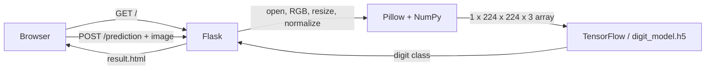
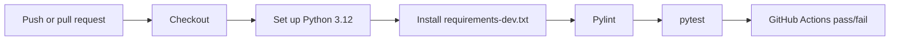

# Hand Digit Image Recognition

Adapted from [Sachin-crypto/Flask_Image_Recognition](https://github.com/Sachin-crypto/Flask_Image_Recognition) for Assignment 2. This Flask app accepts a hand-sign digit image and predicts a class using the bundled Keras model.

## Setup

Use Python 3.12. From the repository root:

```powershell
python -m venv .venv
.venv\Scripts\Activate.ps1
python -m pip install -r requirements-dev.txt
```

On macOS or Linux, activate with `source .venv/bin/activate`. For an app-only install, use `requirements.txt`.

## Run the app

```powershell
python -m flask --app app run
```

Open <http://127.0.0.1:5000>, choose an image from `test_images/`, then submit it. The first prediction loads `digit_model.h5`; later requests reuse the loaded model. The model is now located relative to `model.py`, so no machine-specific path is needed.

## Run checks

```powershell
python -m pylint app.py model.py tests tools
python -m pytest -q
python -m pre_commit install
python -m pre_commit run --all-files
```

The commit hook checks UTF-8 text, final newlines, whitespace, and YAML syntax, then runs Pylint and pytest. Activate the virtual environment before running it. GitHub Actions runs Pylint and pytest on every push and pull request.

## Application flow



- `app.py` configures Flask, validates uploads, and renders the upload and result templates.
- `model.py` preprocesses images and loads the bundled model on first prediction.
- `templates/` holds HTML pages; `static/` holds CSS and JavaScript.
- `test_images/` contains sample hand-sign images.

## CI flow



See `ASSIGNMENT_REPORT.md` for findings, test evidence, and remaining GitHub-only evidence.

## GitHub evidence still needed

The individual repository is https://github.com/Mezeh9481/CSCN73010-Assignment2. Add the reviewed source to that repository and inspect its Actions runs. Add verified run screenshots to the report. No GitHub run is claimed by this local copy.
